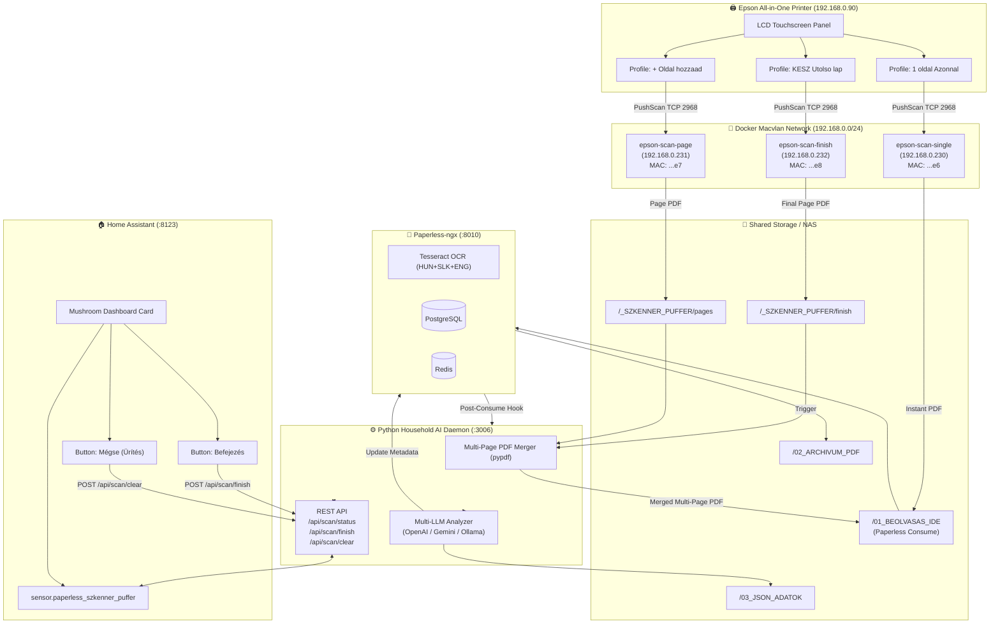

# 🖨️ Epson Paperless Smart Bridge

> **End-to-End Flatbed Multi-Page Push-Scan Bridge for Epson All-in-One Printers to Paperless-ngx with Home Assistant Control & Multi-LLM AI Document Categorization**

[](https://docs.paperless-ngx.com/)
[](https://www.home-assistant.io/)
[](https://www.docker.com/)
[](https://www.python.org/)
[](LICENSE)

---

## 🌟 Overview

Most consumer all-in-one printers (such as the **Epson Expression Premium XP-600 / XP-610 / XP-620** series, EcoTank flatbeds, etc.) lack an **Automatic Document Feeder (ADF)**. While they support scanning to PC over Wi-Fi, using them with modern Document Management Systems like **Paperless-ngx** normally presents major roadblocks:

1. **The Multi-Page Flatbed Trap**: You cannot scan multi-page documents as a single PDF without awkward timeout countdowns (e.g. 30s timers) that rush the user or create fragmented single-page files.
2. **Network Keepalive Collisions**: Running multiple virtual destinations with standard Docker networking causes keepalive packet collisions on UDP 2968—the printer LCD panel shows only one destination or keeps overwriting them.
3. **ESC/I Protocol Dialect Mismatch**: Flatbed-only models reject ADF source probing commands (`ESC e`) with `NAK (0x15)`, causing push-scan sessions to abort before the scanner head ever moves.
4. **Lack of Smart Home Integration**: No easy way to monitor buffer status or trigger document finalization from a smartphone.

**Epson Paperless Smart Bridge** solves all of these problems in a clean, production-proven architecture.

---

## 🚀 Key Features

* **⏱️ Zero-Timeout Multi-Page Staging**: Scan page 1, take your time flipping the page, scan page 2, and so on. No automatic countdown timers force you to rush.
* **📱 Dual Finalization Paths**:
  * **Directly at the Printer LCD**: Press `+ Oldal hozzaad` for each page, and `KESZ Utolso lap` for the final page.
  * **From Home Assistant**: Use `+ Oldal hozzaad` for all pages, then tap the green **Finish** button on your mobile dashboard.
* **🏷️ 3 Dedicated LCD Panel Destinations**:
  * `1 oldal Azonnal`: Immediately ingests single-page bills, receipts, or letters directly to Paperless-ngx.
  * `+ Oldal hozzaad`: Appends the scanned flatbed page to an active multi-page buffer.
  * `KESZ Utolso lap`: Scans the final page, merges all buffered pages into a clean multi-page PDF, and delivers it to Paperless-ngx.
* **🧩 Hardware Dialect Patch**: Includes an in-line patch for `epson2paperless` recognizing fixed-flatbed models (like `PID 08B6` / XP-610) with direct execution (`start-direct`), avoiding ADF probing crashes.
* **🌐 Macvlan Network Isolation & Staggered Keepalives**: Each scanner profile gets a unique physical MAC address and staggered UDP keepalive burst, allowing all 3 profiles to coexist permanently on the printer's screen.
* **🧠 Multi-LLM AI Categorization**: Built-in background daemon analyzing OCR output with **OpenAI (GPT-4o / GPT-6 / Codex OAuth)**, **Ollama**, **Google Gemini**, or **MiniMax**, extracting titles, correspondents, document types, dates, monetary amounts (HUF/EUR), and structured summaries.
* **📦 Parallel JSON Metadata Mirror**: In addition to Paperless-ngx database storage, all categorized metadata is exported as clean, human-readable JSON files alongside the PDF archive.
* **🏡 Home Assistant Integration**: Native package providing a live REST sensor (`sensor.paperless_szkenner_puffer`), input buttons, and custom Mushroom UI cards.

---

## 🏗️ Architecture



---

## 📂 Repository Structure

```text
.
├── docker-compose.yml              # Main Paperless stack (Paperless-ngx, DB, Redis, Daemon, AI)
├── docker-compose.scanner.yml      # Macvlan scanner profile containers (single, page, finish)
├── .env.example                    # Environment template with documented variables
├── patches/
│   ├── registry.js                 # ESC/I dialect patch for fixed-flatbed Epson models
│   └── keepalive.js                # Staggered keepalive responder for panel coexistence
├── scripts/
│   ├── household_ai_and_json_daemon.py # Buffer manager, PDF merger, AI engine & REST API
│   ├── export_json.sh              # Paperless post-consume metadata sync hook
│   └── batch_gmail_harvest_and_ingest.py # Optional email bill harvester
└── homeassistant/
    ├── packages/
    │   └── paperless_szkenner.yaml # Home Assistant REST commands, sensor & automations
    └── dashboard_card.yaml         # Mushroom + Entities card for Lovelace dashboards
```

---

## 🛠️ Installation & Setup

### 1. Prerequisites
* A Linux server or NAS (Ubuntu, Debian, Unraid, TrueNAS, etc.) running Docker and Docker Compose.
* An Epson All-in-One network printer/scanner connected to your local network.
* (Optional) Home Assistant instance for smartphone dashboard controls and notifications.

### 2. Configure Environment
Clone the repository and copy the example environment file:
```bash
git clone https://github.com/M3NT1/epson-paperless-smart-bridge.git
cd epson-paperless-smart-bridge
cp .env.example .env
```
Edit `.env` with your desired passwords, network interfaces, and paths:
* `PRINTER_IP`: IP address of your Epson printer (e.g. `192.168.0.90`).
* `LAN_INTERFACE`: The physical network interface bridged to your LAN (e.g. `eth0` or `ens18`).
* `UNRAID_DOCS_ROOT`: Base directory for documents, buffers, and JSON outputs.
* `AI_PROVIDER`: Choose between `openai-oauth`, `openai`, `ollama`, or `gemini`.

### 3. Start the Core Paperless Stack
```bash
docker compose up -d
```
This starts:
* `paperless-ngx` on port `8010`
* `paperless-db` (PostgreSQL 16)
* `paperless-redis`
* `paperless-household-agent` on port `3006`
* `paperless-ai` review dashboard on port `3005`

### 4. Start the Virtual Scanner Stack
Ensure `patches/registry.js` and `patches/keepalive.js` are in place, then launch the macvlan scanner profiles:
```bash
docker compose -f docker-compose.scanner.yml up -d
```
Within 15–30 seconds, your Epson printer will receive the keepalive announcements and list the destinations on its LCD screen.

### 5. Setup Home Assistant
1. Copy `homeassistant/packages/paperless_szkenner.yaml` to your Home Assistant `/config/packages/` folder.
2. In Home Assistant, create two helper buttons via **Settings ➔ Devices & Services ➔ Helpers**:
   * `input_button.paperless_dokumentum_lezarasa` (Finish & Merge)
   * `input_button.paperless_puffer_uritese` (Cancel / Clear Buffer)
3. Add the card configuration from `homeassistant/dashboard_card.yaml` to your Lovelace dashboard.

---

## 📖 Usage Workflows

### Scenario A: Single-Page Document (Receipt, Bill, Ticket)
1. Place the paper onto the scanner glass.
2. On the printer screen, choose: **Scan ➔ PC ➔ `1 oldal Azonnal` ➔ Start**.
3. **Done!** The PDF is directly ingested by Paperless-ngx, OCR-processed, categorized by AI, and archived.

### Scenario B: Multi-Page Document (Contracts, Multi-Page Invoices)
* **Option 1: Controlled Entirely from the Printer Panel**
  1. Page 1 on glass: select **`+ Oldal hozzaad` ➔ Start**.
  2. Page 2 (and subsequent middle pages): select **`+ Oldal hozzaad` ➔ Start**.
  3. Last page on glass: select **`KESZ Utolso lap` ➔ Start**.
  *(The system scans the last page and immediately merges all pages into a single PDF).*

* **Option 2: Controlled from Home Assistant**
  1. For every page (including the last), select **`+ Oldal hozzaad` ➔ Start**.
  2. When all pages are scanned, open Home Assistant on your phone and tap **Befejezés (Összefűzés & Küldés)**.

---

## 🔍 Technical Lessons Learned & Troubleshooting

| Issue | Root Cause | Solution Implemented |
| :--- | :--- | :--- |
| **`Validation failed in state SOURCE_ACK2 (head=0x15 NAK)`** | Printer is fixed-flatbed only. Default dialect sent `ESC e` to probe for non-existent ADF. | Added `patches/registry.js` mapping `PID 08B6` to `fixed-flatbed` with `start-direct`. |
| **Only 1 destination visible on printer screen** | Multiple containers sharing IP/MAC or firing keepalives at the exact same millisecond. | Configured Docker `macvlan` with distinct MACs and staggered response delays (140 ms steps). |
| **Premature ingestion of multi-page parts** | Paperless recursive consumer scanned subdirectories inside consume folder. | Moved multi-page staging buffer completely outside Paperless consume directory (`_SZKENNER_PUFFER`). |
| **Missing root permissions in Docker** | Python container unprivileged user (`99:100`) could not install packages to system python. | Dynamically injected dependencies (`pypdf`) into `/tmp/pylib` at runtime. |

---

## 📄 License

This project is licensed under the [MIT License](LICENSE).
Epson is a registered trademark of Seiko Epson Corporation. This project is an independent community development and is not affiliated with or endorsed by Seiko Epson Corporation or Paperless-ngx.
