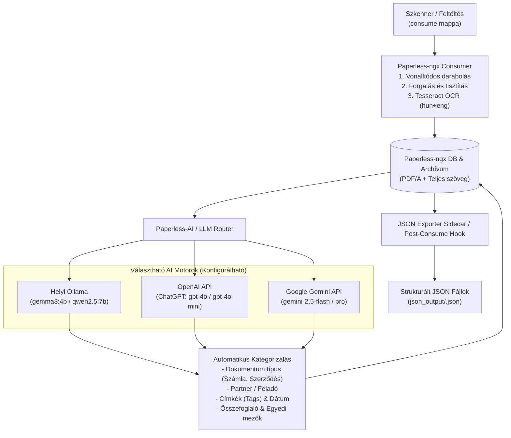

# Papírdigitalizáló, OCR, AI Kategorizáló és JSON Export Rendszerterv

**Készült:** 2026.11.03.  
**Célkörnyezet:** `mentissant` (Intel NUC Homelab Server)  
**Munkakönyvtár:** `/home/menti/HAZ/PAPIRDIGITALOZALAS`

---

## 1. Hardver és Docker Környezet Audit (Állapotfelmérés)

A NUC szerveren elvégzett diagnosztika alapján a következő erőforrások és adottságok állnak rendelkezésre:

### 1.1. Hardver specifikációk
| Erőforrás | Jelenlegi érték | Értékelés a feladathoz |
| :--- | :--- | :--- |
| **CPU** | 13th Gen Intel Core i5-1340P (12 vCPU szál) | **Kiváló** többszálú Tesseract OCR-hez és PDF feldolgozáshoz. |
| **RAM** | **46 GiB** (ebből **~39 GiB szabad/elérhető**) | **Bőséges.** A teljes DMS + adatbázis + OCR + AI pipeline kényelmesen elfér. |
| **GPU / Gyorsítás** | Virtuális VGA (`1234:1111`), nincs dedikált GPU passthrough | A helyi LLM (Ollama) **CPU-ból és RAM-ból** fut. Emiatt helyben kisebb modellek (`gemma3:4b`, `qwen2.5:7b`) javasoltak, vagy felhős API (ChatGPT / Gemini). |
| **Helyi SSD (`/`)** | 322 GB össz / **29 GB szabad (91% telített!)** | **KRITIKUS SZŰK KERESZTMETSZET!** Nagy tömegű PDF-et nem szabad a helyi `/` lemezen tárolni. *(Megjegyzés: `docker system prune`-nal ~42 GB felszabadítható a régi image-ekből és build cache-ből).* |
| **Hálózati tárhely (NAS)** | `/mnt/hermes-workdir` (`//192.168.0.32/_HERMES_WORKDIR`) – **6.5 TB szabad** (11 TB-ból) | **Ideális adattárhely** a beolvasott PDF-eknek, az archívumnak és a generált JSON fájloknak. |

### 1.2. Meglévő Docker ökoszisztéma (amit újrahasznosítunk)
* **Hálózat:** Van egy központi `ai-network` (`172.19.0.0/16`) bridge hálózat, amelyen a fő szolgáltatások már látják egymást.
* **`ollama-local` (`172.19.0.4:11434`):** Már fut és elérhető! Telepített modellek: `gemma3:1b`, `gemma3:4b`, `gemma3:12b`.
* **`n8n` (`172.19.0.5:5678`):** Már fut az `ai-network`-ön! Kiválóan használható összetett AI munkafolyamatokhoz (ChatGPT/Gemini/JSON transzformáció).
* **`filebrowser` (`8090`) & `nginx-proxy-manager` (`80/443`):** Már futnak.
* **Portütközés figyelmeztetés:** A `8000`-es portot jelenleg a `portainer` használja, a `8080`-at a `dozzle`, a `3001`-et az `uptime-kuma`. Ezért az új szolgáltatásokat a **`8010`** (Paperless-ngx) és **`3005`** (Paperless-AI) portokra tervezzük.

---

## 2. Rendszerarchitektúra és Munkafolyamat (Pipeline)

A rendszer célja, hogy egy megadott mappába (`consume`) bedobott szkennelt dokumentumokat emberi beavatkozás nélkül feldolgozza, kategorizálja, és minden dokumentumról egy strukturált `.json` fájlt is előállítson.



---

## 3. Hibrid Tárolási Stratégia (SSD + NAS)

Mivel a helyi SSD-n csak 29 GB szabad hely van, de az adatbázisoknak (PostgreSQL, Redis) gyors és megbízható fájlzárolásra (POSIX file locking) van szükségük:

1. **Helyi SSD-n marad (`/home/menti/HAZ/PAPIRDIGITALOZALAS/local_data`):**
   * PostgreSQL adatbázis (`pgdata`)
   * Redis cache és keresőindex (`paperless_data/index`)
   * Docker konfigurációk, script-ek
2. **NAS-ra kerül (`/mnt/hermes-workdir/papirdigitalizalas`):**
   * `consume/` – **Bejövő mappa:** ide ment a szkenner, vagy ide másolod a nyers fájlokat.
   * `media/` – **Feldolgozott archívum:** az eredeti és az OCR-ezett PDF/A fájlok.
   * `json_output/` – **JSON kimeneti mappa:** minden dokumentum teljes szövege és AI metaadatai külön `.json` fájlban.
   * `export/` – Teljes rendszermentések.

---

## 4. Hogyan lesz minden dokumentum JSON-ban elérhető?

A terv **három szinten** biztosítja a JSON alapú hozzáférést:

### 4.1. Automatikus fájlszintű JSON generálás (`json_output/<id>_<cim>.json`)
Egy dedikált post-processing script (és egy könnyűsúlyú szinkronizáló konténer/hook) minden beolvasás és AI-kategorizálás után kiír egy önálló, tiszta JSON fájlt a `json_output/` mappába az alábbi sémával:

```json
{
  "id": 1042,
  "title": "MVM Next Villamosenergia elszámoló számla",
  "original_filename": "scan_20261103_001.pdf",
  "created_date": "2026-10-21",
  "added_at": "2026-11-03T07:15:22Z",
  "correspondent": {
    "id": 4,
    "name": "MVM Next Energiakereskedelmi Zrt."
  },
  "document_type": {
    "id": 2,
    "name": "Közüzemi számla"
  },
  "tags": ["rezsi", "villany", "2026", "befizetendő"],
  "archive_serial_number": 20260042,
  "custom_fields": {
    "osszeg_huf": 18450,
    "fizetesi_hatarido": "2026-11-05",
    "szamlaszam": "8492019482"
  },
  "ai_analysis": {
    "summary": "2026. októberi havi villamosenergia számla...",
    "provider": "gemini-2.5-flash",
    "processed_at": "2026-11-03T07:15:40Z"
  },
  "ocr_text": "MVM Next Energiakereskedelmi Zrt. Számla sorszáma: 8492019482...",
  "files": {
    "archive_pdf": "/mnt/hermes-workdir/papirdigitalizalas/media/documents/archive/0001042.pdf",
    "original_pdf": "/mnt/hermes-workdir/papirdigitalizalas/media/documents/originals/0001042.pdf"
  }
}
```

### 4.2. REST API elérés (külső scripteknek, ChatGPT/Gemini ügynököknek, n8n-nek)
A Paperless-ngx teljes körű JSON REST API-val rendelkezik:
* `GET http://192.168.0.77:8010/api/documents/` – összes dokumentum listázása és szűrése JSON-ban.
* `GET http://192.168.0.77:8010/api/documents/{id}/` – adott dokumentum összes metaadata és teljes `content` (OCR szöveg) mezője JSON-ban.

---

## 5. Multi-AI Támogatás: Ollama, ChatGPT (OpenAI) és Google Gemini

A rendszer úgy épül fel, hogy **bármikor egyetlen beállítással válthass** a helyi ingyenes AI és a felhős nagyágyúk között, vagy akár kombináld őket:

1. **1. Fázis (Helyi, azonnali indulás - Ingyenes, 100% privát):**
   * A már futó `ollama-local` konténeredet használja az `ai-network`-ön keresztül (`http://ollama-local:11434`).
   * Modell: A meglévő `gemma3:4b` (gyors CPU-n) vagy letölthető a `qwen2.5:7b` (kiemelkedő magyar nyelvi és JSON-struktúra pontosság).
2. **2. Fázis (OpenAI ChatGPT integráció):**
   * A `Paperless-AI` natívan támogatja az OpenAI-t (`LLM_PROVIDER=openai`, `OPENAI_API_KEY=sk-...`, modell: `gpt-4o-mini` vagy `gpt-4o`).
   * A `gpt-4o-mini` filléres költséggel (1000 oldal ~ pár tíz forint) és 1 másodperc alatti válaszidővel, NUC CPU-terhelés nélkül kategorizál.
3. **3. Fázis (Google Gemini integráció):**
   * **Közvetlenül a Paperless-AI-ban:** A Gemini biztosít OpenAI-kompatibilis végpontot (`https://generativelanguage.googleapis.com/v1beta/openai/`), így a `gemini-2.5-flash` vagy `gemini-2.5-pro` közvetlenül beköthető!
   * **Multimodális (Képalapú) OCR + Elemzés n8n-en keresztül:** Ha kézzel írott vagy nagyon rossz minőségű papírt szkennelsz, a már futó `n8n` konténered közvetlenül átadhatja a PDF-et a **Gemini Vision API**-nak, ami a képről olvassa le a magyar kézírást és táblázatokat, majd visszaírja a Paperless-be és a JSON fájlba.

---

## 6. Konkrét Megvalósítási Terv (`docker-compose.yml` vázlat)

A projekt a `/home/menti/HAZ/PAPIRDIGITALOZALAS` mappában az alábbi komponensekből fog állni:

```yaml
name: papirdigitalizalas

services:
  # 1. PostgreSQL adatbázis (Helyi SSD-n a sebesség és stabilitás miatt)
  paperless-db:
    image: postgres:16-alpine
    container_name: paperless-db
    restart: unless-stopped
    volumes:
      - ./local_data/pgdata:/var/lib/postgresql/data
    environment:
      POSTGRES_DB: paperless
      POSTGRES_USER: paperless
      POSTGRES_PASSWORD: ${POSTGRES_PASSWORD:-paperless_secret_2026}
    networks:
      - ai-network

  # 2. Redis broker a háttérfolyamatokhoz
  paperless-redis:
    image: redis:7-alpine
    container_name: paperless-redis
    restart: unless-stopped
    volumes:
      - ./local_data/redis:/data
    networks:
      - ai-network

  # 3. Paperless-ngx Főmotor (OCR + Kategorizálás + Archívum)
  paperless-ngx:
    image: ghcr.io/paperless-ngx/paperless-ngx:latest
    container_name: paperless-ngx
    restart: unless-stopped
    depends_on:
      - paperless-db
      - paperless-redis
    ports:
      - "8010:8000"
    environment:
      PAPERLESS_REDIS: redis://paperless-redis:6379
      PAPERLESS_DBHOST: paperless-db
      PAPERLESS_DBNAME: paperless
      PAPERLESS_DBUSER: paperless
      PAPERLESS_DBPASS: ${POSTGRES_PASSWORD:-paperless_secret_2026}
      PAPERLESS_SECRET_KEY: ${PAPERLESS_SECRET_KEY:-generate_long_random_secret_here}
      PAPERLESS_TIME_ZONE: Europe/Budapest
      
      # Magyar + Angol OCR
      PAPERLESS_OCR_LANGUAGE: hun+eng
      PAPERLESS_OCR_LANGUAGES: hun eng
      PAPERLESS_OCR_MODE: skip
      PAPERLESS_OCR_CLEAN: clean
      PAPERLESS_OCR_DESKEW: "true"
      PAPERLESS_OCR_ROTATE_PAGES: "true"
      
      # CPU optimalizálás az i5-1340P (12 szál) mellé
      PAPERLESS_TASK_WORKERS: 2
      PAPERLESS_THREADS_PER_WORKER: 3
      
      # CIFS/SMB (NAS) mappa figyelés kompatibilitás (polling)
      PAPERLESS_CONSUMER_POLLING: 10
      PAPERLESS_CONSUMER_RECURSIVE: "true"
      PAPERLESS_CONSUMER_SUBDIRS_AS_TAGS: "true"
      
      # Tömeges szkennelés vonalkódos elválasztólapokkal
      PAPERLESS_CONSUMER_ENABLE_BARCODES: "true"
      PAPERLESS_CONSUMER_BARCODE_SCANNER: zxing
      PAPERLESS_CONSUMER_ENABLE_ASN_BARCODE: "true"
      
      # Post-consume hook a JSON fájlok azonnali generálásához
      PAPERLESS_POST_CONSUME_SCRIPT: /usr/src/paperless/scripts/export_json.sh
    volumes:
      - ./local_data/data:/usr/src/paperless/data
      - ./scripts:/usr/src/paperless/scripts:ro
      - /mnt/hermes-workdir/papirdigitalizalas/media:/usr/src/paperless/media
      - /mnt/hermes-workdir/papirdigitalizalas/consume:/usr/src/paperless/consume
      - /mnt/hermes-workdir/papirdigitalizalas/export:/usr/src/paperless/export
      - /mnt/hermes-workdir/papirdigitalizalas/json_output:/usr/src/paperless/json_output
    networks:
      - ai-network

  # 4. Paperless-AI (Ollama / ChatGPT / Gemini integráció)
  paperless-ai:
    image: ghcr.io/clusterzx/paperless-ai:latest
    container_name: paperless-ai
    restart: unless-stopped
    depends_on:
      - paperless-ngx
    ports:
      - "3005:3000"
    volumes:
      - ./local_data/paperless-ai:/app/data
    networks:
      - ai-network

  # 5. JSON Sync Worker (Folyamatosan szinkronban tartja a .json fájlokat az AI módosítások után is)
  paperless-json-sync:
    image: python:3.12-slim
    container_name: paperless-json-sync
    restart: unless-stopped
    depends_on:
      - paperless-ngx
    volumes:
      - ./scripts:/app:ro
      - /mnt/hermes-workdir/papirdigitalizalas/json_output:/json_output
    environment:
      PAPERLESS_URL: http://paperless-ngx:8000
      PAPERLESS_TOKEN: ${PAPERLESS_API_TOKEN:-}
      SYNC_INTERVAL_SECONDS: 30
    command: ["python3", "/app/json_sync_daemon.py"]
    networks:
      - ai-network

networks:
  ai-network:
    external: true
```

---

## 7. Bevezetési Lépések (Ütemterv)

1. **0. Lépés – Docker takarítás (Opcionális, de erősen ajánlott):**
   * A régi, leállított biztonsági mentés konténerek és a 42 GB-nyi árva Docker build cache / image felszabadítása a helyi SSD-n, hogy a 91%-os telítettség ~75%-ra csökkenjen.
2. **1. Lépés – Mappastruktúra létrehozása:**
   * A `/mnt/hermes-workdir/papirdigitalizalas/{consume,media,export,json_output}` mappák létrehozása a NAS-on.
   * A `/home/menti/HAZ/PAPIRDIGITALOZALAS/{local_data,scripts}` létrehozása a NUC-on.
3. **2. Lépés – JSON Export & Sync Scriptek elkészítése:**
   * `export_json.sh` (azonnali JSON kivonat a beolvasás pillanatában).
   * `json_sync_daemon.py` (amikor az AI vagy te módosítod a kategóriát/címkét, automatikusan frissíti a dokumentum `.json` fájlját a `json_output` mappában).
4. **3. Lépés – Konténerek elindítása és összekötése:**
   * `paperless-ngx` elindítása (`:8010`), admin fiók és API token generálása.
   * `paperless-ai` (`:3005`) összekötése a meglévő `ollama-local` (`gemma3:4b`) szolgáltatással, valamint az OpenAI (ChatGPT) / Google Gemini API kulcsok helyének előkészítése.
5. **4. Lépés – Tesztelés valós dokumentummal:**
   * Egy teszt PDF/kép bedobása a `consume` mappába -> OCR ellenőrzése -> AI kategorizálás ellenőrzése -> generált `.json` fájl ellenőrzése.
